<p align="center">
  
</p>

<h1 align="center">Coffer</h1>

<p align="center">
  An encrypted file vault in your Telegram Saved Messages
</p>

<p align="center">
  <a href="https://esdex.github.io/Coffer/">Documentation</a> | <a href="https://esdex.github.io/Coffer/privacy.html">Privacy policy</a>
</p>

<p align="center">
  <a href="https://www.gnu.org/licenses/gpl-3.0.html"></a>
  
  
  
</p>

---

## Screenshots

<p align="center">
  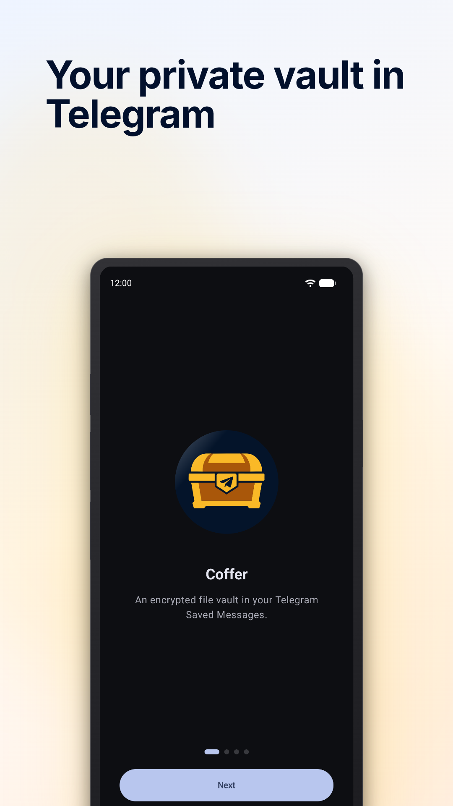
  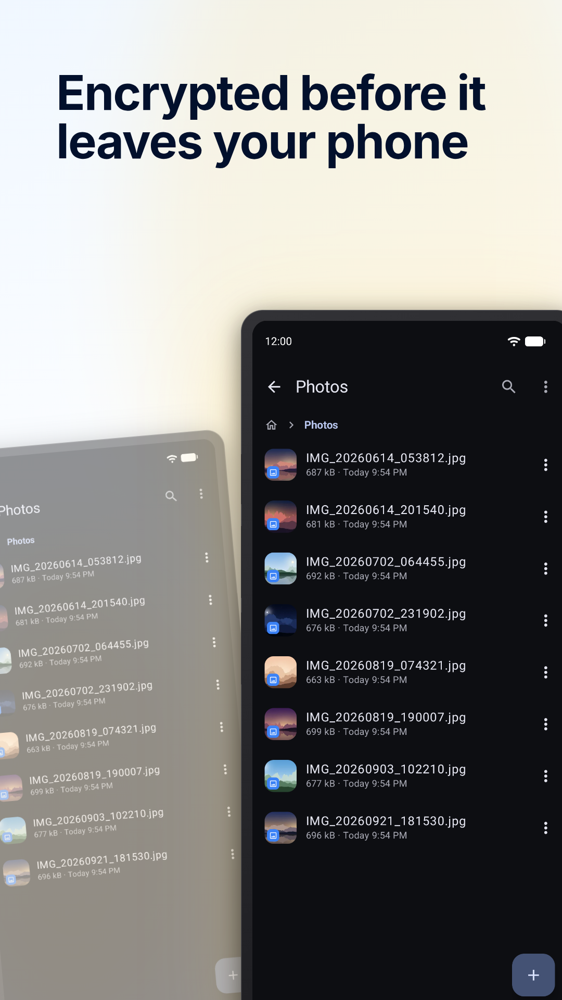
  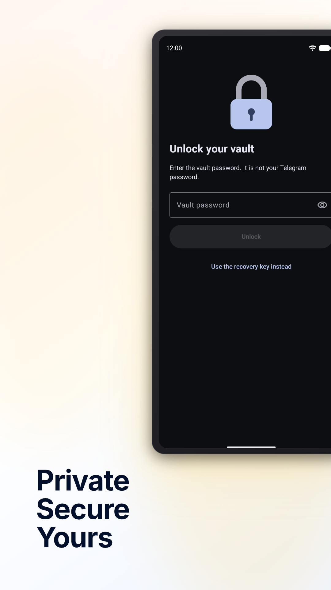
  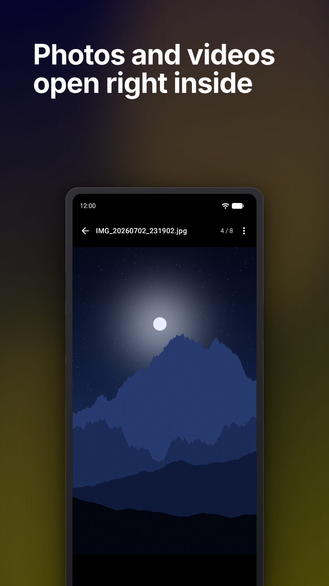
</p>

<p align="center">
  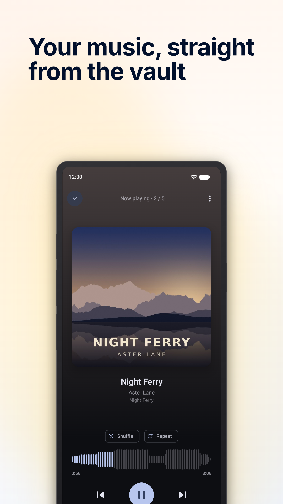
  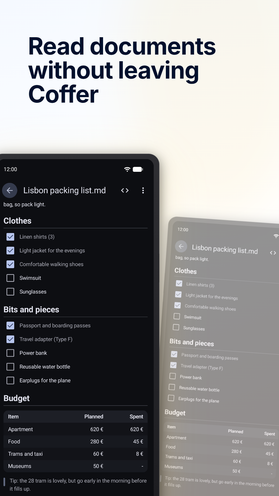
  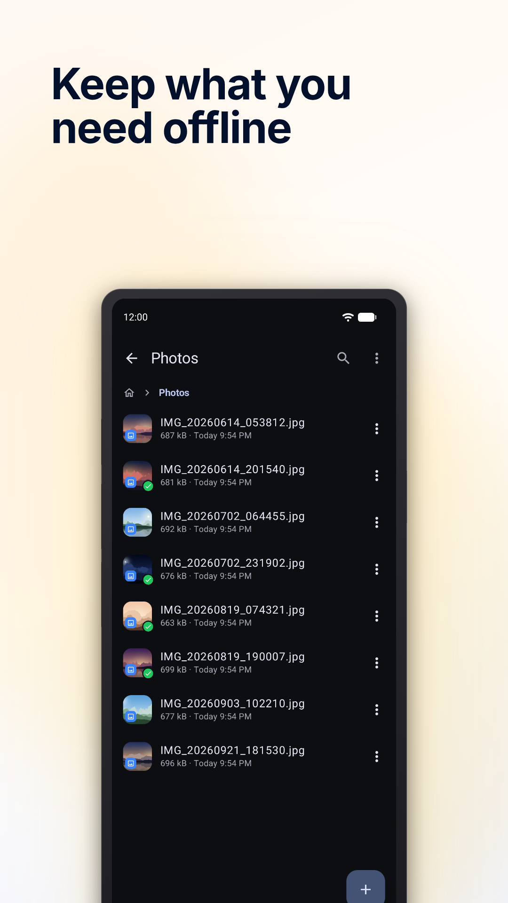
</p>

---

## Features

**Encryption**
- 🔐 Files, file names and folders are encrypted on the phone before anything is sent
- 🔒 XChaCha20-Poly1305 with libsodium; the vault password is stretched with Argon2id (128 MiB, 4 passes)
- 🗝️ A 24-word recovery key opens the vault if the password is forgotten
- 📏 File sizes and name lengths hidden from Telegram: contents and captions are padded inside the encryption
- 📱 The key to your files leaves the phone only locked under your password

**Storage**
- 💬 Files live in the Saved Messages of your own Telegram account, as documents
- 🚫 No server of its own: Coffer talks straight to Telegram with your account
- 🔄 Sign in on another phone and every file is there; changes on one device show up on the others
- 📤 Large files are uploaded in parts, and interrupted uploads resume
- 🗃️ Index snapshots, so a new device does not have to read the whole history
- 🩺 A weekly integrity check finds missing parts and cleans up leftovers

**Files**
- 📂 Folders: create, rename, move and delete, with search and sorting
- 📥 Add whole folders from the phone, and save folders back with their subfolders
- ☑️ Select several files to move, save or delete them together; a delete can be undone for a few seconds
- 📴 Keep chosen files or folders on the phone, to open them with no network
- 💾 An encrypted file cache, with its own size limit
- 🖼️ Previews for photos, videos and songs, kept on the phone encrypted

**Viewers**
- 🎞️ Photos and videos open in Coffer, read from Telegram a piece at a time and never written out decrypted
- ▶️ A video plays before it is downloaded, with seeking, gestures and speed control
- 🎵 Music with cover, tags and the song's waveform, playing in the background and on the lock screen
- 📄 PDFs, decrypted into memory, with zoom and a page counter
- 📝 Text and code files with syntax colours; Markdown formatted, with checkboxes and tables

**Privacy**
- 👆 Unlock with fingerprint or face; the phone's PIN does not open the vault
- 🔏 Auto-lock after a few minutes in the background
- 📵 Screenshots blocked wherever the recovery key shows, and anywhere else if you choose
- ⏳ Decrypted copies opened in another app are removed after about 10 minutes, or when the vault locks
- 🕵️ No analytics, no ads, no tracking

**UI**
- 🎨 Material 3 with Material You colours, dark and pure black themes
- 🌙 Frosted glass bars on pure black
- ✨ Animations drawn in the app itself, in the theme's colours

---

## How it works

Coffer turns your Saved Messages into encrypted storage. Each file is encrypted on the phone and sent as a document with a random name, like `cfr_1a2b3c4d5e6f.bin`. Next to them Coffer keeps short text notes starting with `coffer:`: the vault header, which holds the vault key encrypted under your password, and a log of changes to folders and names, all encrypted. Another device signed in to the same account reads the same messages and rebuilds the same vault.

Telegram sees documents of padded sizes and notes of fixed lengths. It does not see names, folders, types or, with the default settings, exact sizes.

Coffer uses TDLib, Telegram's own client library, built from pinned sources. It sends documents only, never media, waits out Telegram's flood limits honestly, and runs at most 3 transfers at a time.

---

## Installation

<p>
  <a href="https://github.com/Esdex/Coffer/releases/latest"></a>
</p>

<!-- TODO: add the F-Droid and Google Play badges once published -->

**Verify the APK.** Releases are signed with Coffer's own key. Before installing, you can check that the APK's signing certificate has this SHA-256 fingerprint, for example with [AppVerifier](https://github.com/soupslurpr/AppVerifier):

```
me.esdex.coffer
25:86:4E:BB:45:B9:47:81:8F:85:1E:E5:36:45:F7:7D:9E:A4:27:AC:1C:EE:7C:C7:B2:89:B0:00:A1:77:0D:7F
```

### Build from source

```bash
git clone https://github.com/Esdex/Coffer.git
cd Coffer
scripts/build-tdlib.sh
./gradlew assemblePublicFdroidRelease
```

**Requirements:**
- Any JDK to start Gradle: `gradle/gradle-daemon-jvm.properties` pins the Gradle daemon to toolchain 25, and Gradle provisions it itself
- Android NDK 28.2.13676358 and the Android SDK, for TDLib
- `scripts/build-tdlib.sh` builds TDLib 1.8.69 from its pinned commit, with OpenSSL 3.5 checked against its SHA-256. It needs several GB of disk and takes a while; run `scripts/build-tdlib.sh --check` first to verify the toolchain
- Min SDK 30 / Target SDK 37, ABIs arm64-v8a and x86_64

The APK comes out unsigned: sign it with your own key, or take a signed one from the releases.

The `fdroid` flavor is the build for GitHub Releases and F-Droid. The `playstore` flavor leaves out the donation page, as Google Play's payments policy asks.

**Telegram API keys.** The `public` flavor builds with Coffer's own keys from `app/public-api-keys.properties`. They are in the repository on purpose: F-Droid builds Coffer from this source and publishes the APK signed with Coffer's key only if its build matches it byte for byte, and the keys are in every published APK anyway. Without that file, each user enters their own `api_id` and `api_hash` from [my.telegram.org](https://my.telegram.org) at sign-in. The `personal` flavor reads its keys from `COFFER_API_ID` and `COFFER_API_HASH` in `local.properties`, which stays out of git.

---

## Architecture

| Layer | Technology |
|---|---|
| UI | Kotlin + Jetpack Compose (Material 3), single Activity |
| Telegram | TDLib 1.8.69, built from source, through its Java interface |
| Crypto | `:core:crypto`, pure Kotlin over libsodium (lazysodium): XChaCha20-Poly1305, Argon2id, BLAKE2b |
| Vault format | Encrypted blobs, a vault header and an operation log in Saved Messages, CBOR inside |
| Sync | `:core:sync`, tested against a fake storage backend on the JVM |
| Local index | Room over SQLCipher, key in the Android Keystore |
| DI | Hilt |
| Background work | WorkManager, one queue for all transfers |
| Media | Media3 / ExoPlayer, reading straight from Telegram |

Modules: `:core:crypto`, `:core:storage`, `:core:tdlib`, `:core:vault`, `:core:index`, `:core:sync`, `:core:ui`, `:feature:onboarding`, `:feature:browser`, `:feature:settings`, `:app`.

---

## Security

The codebase has been reviewed using AI-assisted security analysis, in two full audits before the first release. Reports are published in [`/audits`](audits/).

**Reporting a vulnerability:** Please use [GitHub Security Advisories](https://github.com/Esdex/Coffer/security/advisories/new) to report security issues privately. Do not open a public issue for vulnerabilities.

---

## Contributing

Contributions are welcome for bug fixes and non-cryptographic improvements (UI, translations, documentation, viewers). For changes touching the crypto layer, the vault format, sync or anything else security-critical, please open an issue first to discuss the approach.

- Run `./gradlew test` and `./gradlew lint` before submitting
- The vault format is a contract: a change to it needs a new format version, and old vaults must keep opening
- Cryptography lives only in `:core:crypto`
- New sync logic comes with tests on the fake storage backend first
- No keys, passwords, recovery words, file names or decrypted metadata in logs

---

## Support

If Coffer is useful to you, you can support its development:

<p>
  <a href="https://github.com/sponsors/Esdex"></a>
  &nbsp;
  <a href="https://ko-fi.com/Esdex"></a>
</p>

### Crypto

**Bitcoin**


```
bc1qk3pjpxfzafpc56924m8hnyewcgmutchwrg4v2p
```

---

**Bitcoin Lightning**

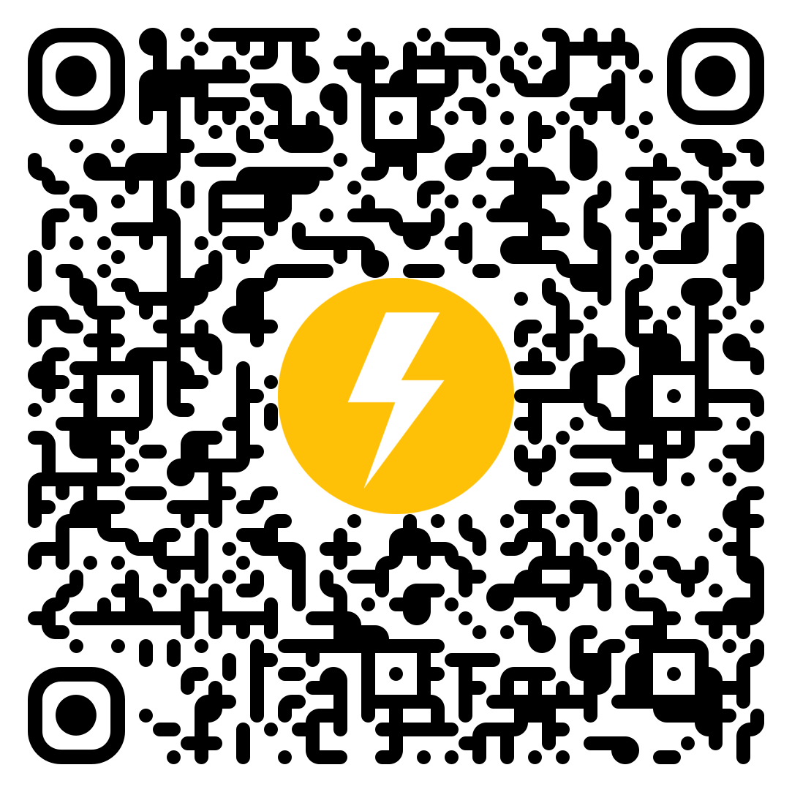

```
esdex@cake.cash
```

---

**Ethereum**

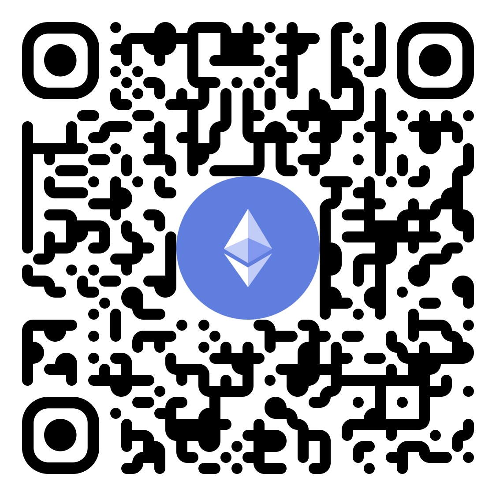

```
0xDc4B00d937e4a9633d37d70dDF56E8370f44E0f8
```

---

**Monero**

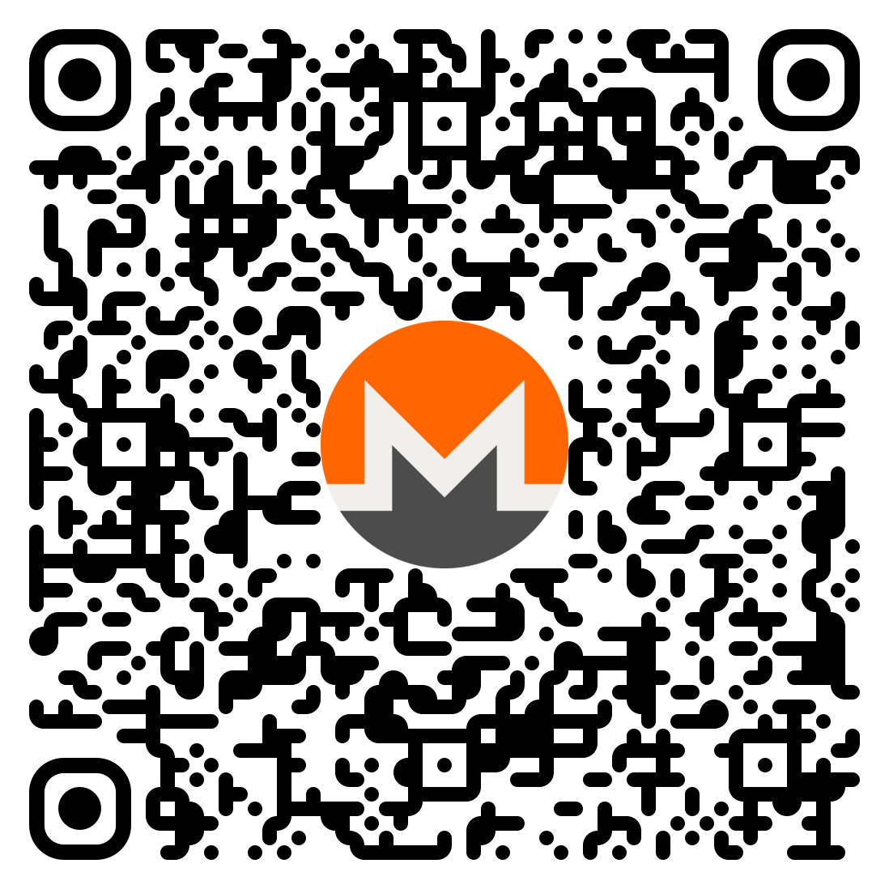

```
83xHcG9NNzLhsYQ9QoMcX2EFCwEPT1rSSa4EPgDMG3PqQEXVZ1vgaTtAq9x4zETjkRRK7CiH6giHshTLUJHTD4mCRBbt42s
```

---

**Solana / USDT / USDC**

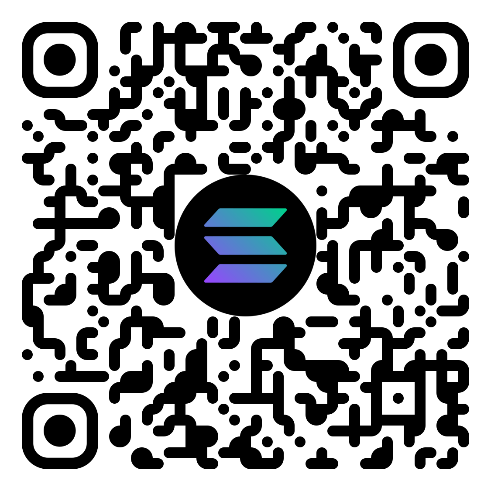

```
GJgu5VqmEfxfQQbRpp9CDcYUxjsjUPJpHsCfyjRQGGSX
```

## License

```
Copyright 2026 Esdex

Coffer is free software: you can redistribute it and/or modify it under the terms of the GNU
General Public License as published by the Free Software Foundation, either version 3 of the
License, or (at your option) any later version. See LICENSE.
```

Coffer is not affiliated with or endorsed by Telegram.

---

## Acknowledgments

- **[TDLib](https://github.com/tdlib/td)**: the Telegram client library under every request
- **[libsodium](https://libsodium.org)** and **[Lazysodium](https://github.com/terl/lazysodium-android)**: XChaCha20-Poly1305, Argon2id, BLAKE2b
- **[OpenSSL](https://www.openssl.org)**: built into TDLib
- **[SQLCipher](https://www.zetetic.net/sqlcipher/)**: encryption of Coffer's own index database
- **[Media3 / ExoPlayer](https://developer.android.com/media/media3)**: video and music, read straight from Telegram
- **[Haze](https://github.com/chrisbanes/haze)**: frosted glass effects
- **[ZXing](https://github.com/zxing/zxing)**: the QR code for signing in
- **[zxcvbn4j](https://github.com/nulab/zxcvbn4j)**: password strength
- **[BIP39](https://github.com/bitcoin/bips/blob/master/bip-0039.mediawiki)**: the English word list of the recovery key
